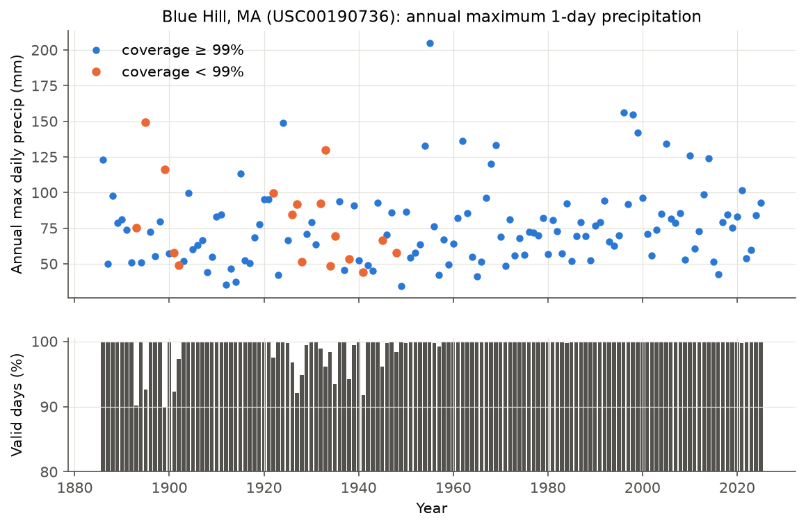
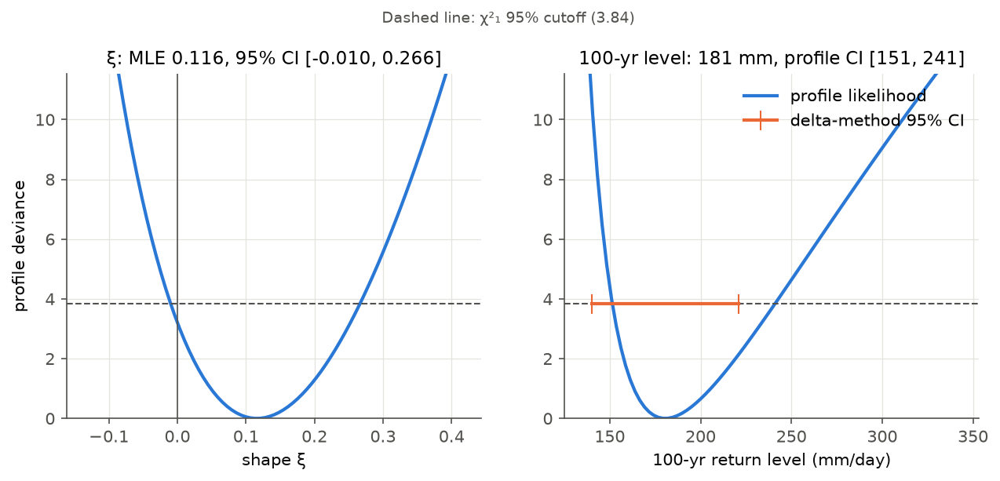
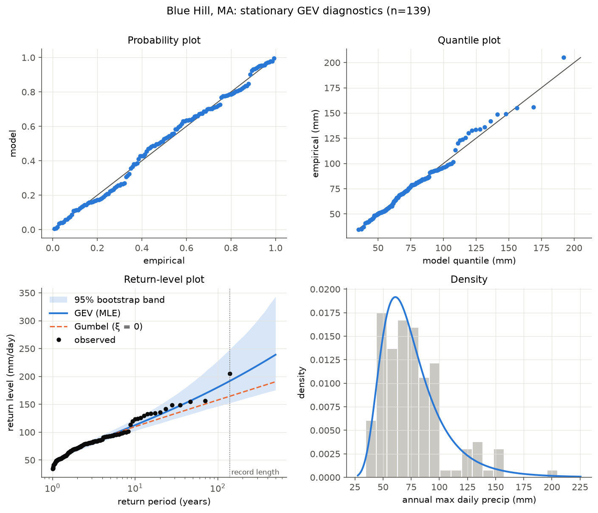
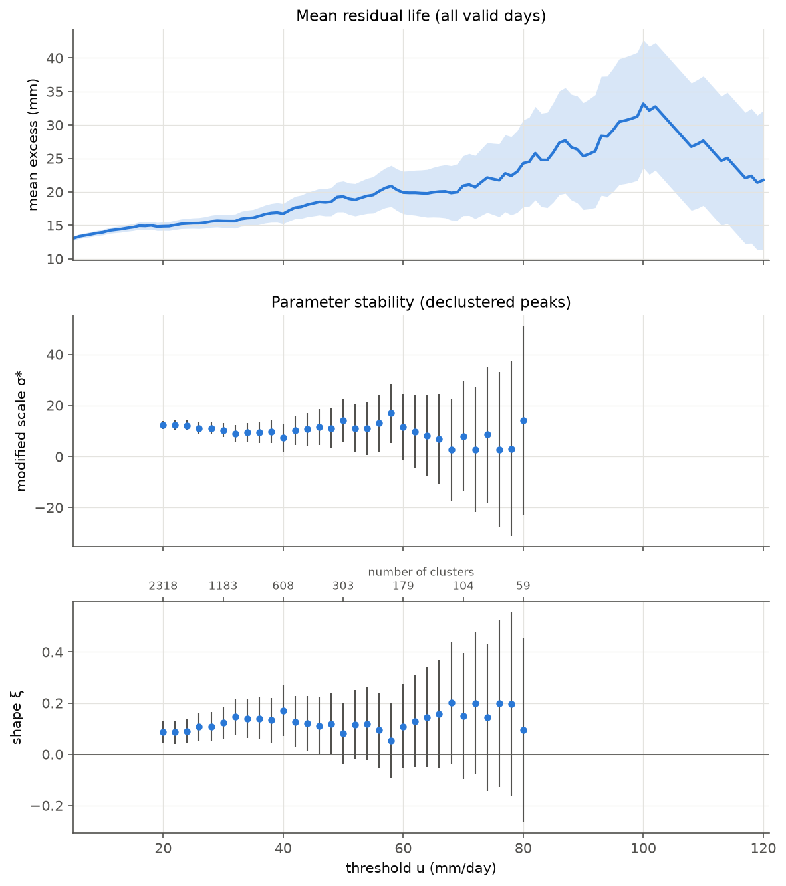
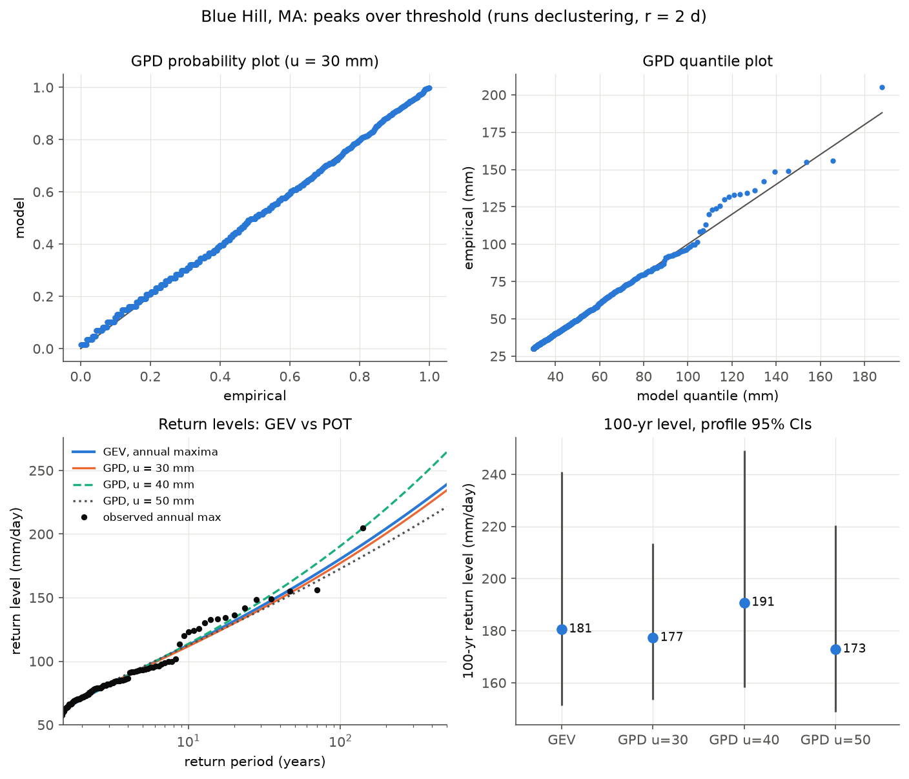
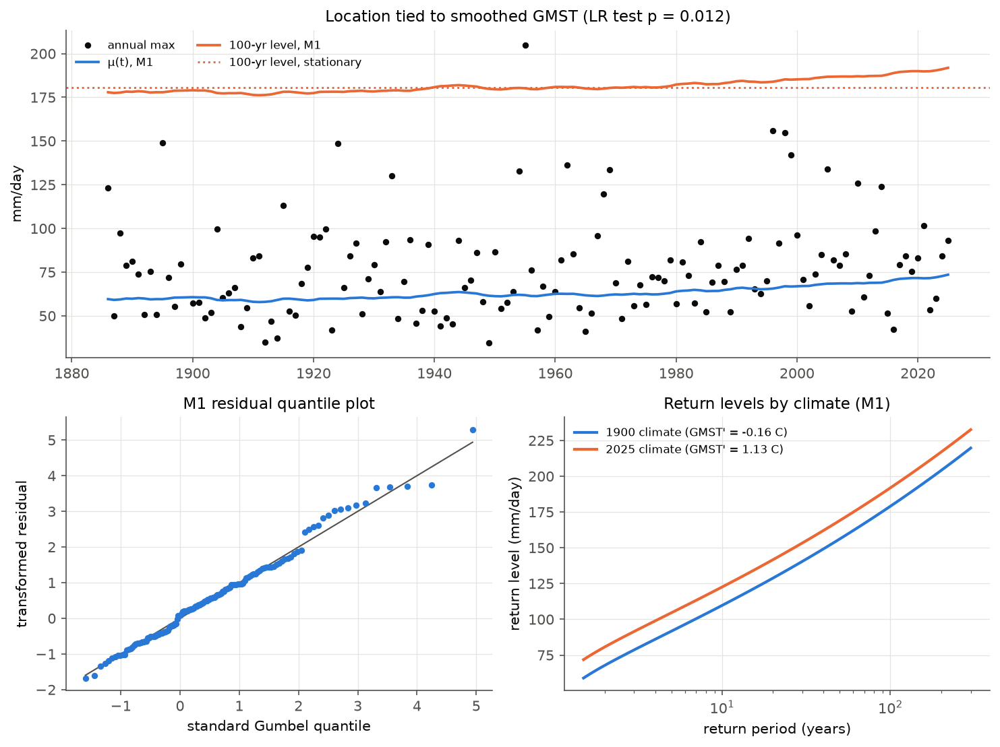

# Extreme daily precipitation at Blue Hill, MA (GHCN-Daily, 1886–2025)

A small, reproducible extreme-value analysis of annual-maximum and peaks-over-threshold
daily precipitation at Blue Hill Observatory (GHCN-Daily `USC00190736`, Milton, MA).
Estimators, return levels, confidence intervals and goodness-of-fit tests are written out
explicitly in `src/evtlib.py` (NumPy/SciPy only, following Coles 2001) and checked against
`scipy.stats` on simulated data.

Xi Chen, October 2026. Every analysis choice, and the reason for it, is recorded in `src/config.py`.

## Results at a glance

| | Value |
|---|---|
| Sample | 139 annual maxima, 1886–2025 (years with ≥90% valid days) |
| GEV (MLE) | μ = 63.1 (se 1.9) mm, σ = 19.3 (1.4) mm, ξ = 0.116 (0.071); profile 95% CI for ξ [−0.010, 0.266] |
| Gumbel vs GEV | LR test of ξ = 0: D = 3.21, p = 0.073 (heavy tail not established at 5%) |
| 100-yr daily total | 181 mm, profile 95% CI [151, 241] (GEV); 177 mm [154, 213] (POT, u = 30 mm) |
| GoF, GEV | Anderson–Darling p = 0.14, KS p = 0.27 (parametric bootstrap, B = 2000) |
| Non-stationary GEV | μ = μ₀ + μ₁·GMST′, μ₁ = 9.9 mm/K (bootstrap 95% CI 2.3–18.2); LR test p = 0.012 |
| 1900 → 2025 climate | every return level +12.9 mm (95% CI 3.0–23.5); 100-yr level 179 → 192 mm |

The largest value in the record is 205 mm on 1955-08-19 (the Hurricane Diane floods),
about a 200-year event under the stationary GEV fit.

## Data

- **Precipitation:** NOAA NCEI GHCN-Daily station CSV, downloaded 2026-10-23 (URL and
  SHA-256 in `data/raw/DOWNLOAD_INFO.txt`). `PRCP` is in tenths of mm, recorded to 0.01 inch.
- **QC:** 53 values with a non-blank quality flag were removed (all flag `L`, failed
  multiday-period check; mostly a zero followed by a likely multi-day accumulation).
- **Completeness:** missing days can only lower an annual maximum, so incomplete years bias
  return levels low. Main analysis keeps years with ≥90% valid days (139 of 140; drops 1899,
  which also misses 37 days in June–October); ≥99% (123 years) is a sensitivity check.
  2026 is excluded as incomplete.
- **GMST:** NASA GISTEMP v4 global annual anomaly (vs 1951–1980), 4-year trailing mean.



## Methods and results

### 1. GEV for annual maxima (`src/02_gev_fit.py`)

Shape convention: ξ > 0 is a heavy upper tail. `scipy.stats.genextreme` uses c = −ξ
(and `genpareto` uses c = +ξ); `src/00_selfcheck.py` verifies both against `evtlib`.

| Parameter | MLE (se) | L-moments | Gumbel MLE |
|---|---|---|---|
| μ (mm) | 63.05 (1.87) | 63.18 | 64.30 |
| σ (mm) | 19.33 (1.43) | 19.78 | 20.31 |
| ξ | 0.116 (0.071) | 0.095 | 0 |
| log-likelihood | −640.38 | −640.47 | −641.98 |

Return levels (mm/day), 95% CIs. Profile likelihood is the pre-specified main interval.

| T (yr) | MLE | Profile | Delta method | Param. bootstrap | L-moments (bootstrap CI) |
|---|---|---|---|---|---|
| 2 | 70.3 | [66.2, 74.7] | [66.1, 74.5] | [66.1, 74.9] | 70.6 [66.2, 74.8] |
| 10 | 112.7 | [103.7, 126.1] | [102.1, 123.4] | [102.6, 123.9] | 112.8 [103.2, 123.2] |
| 25 | 137.9 | [123.1, 163.9] | [119.0, 156.8] | [120.3, 158.2] | 137.1 [121.4, 155.7] |
| 50 | 158.4 | [137.4, 199.0] | [130.2, 186.6] | [133.4, 190.2] | 156.7 [134.3, 185.7] |
| 100 | 180.5 | [151.4, 241.0] | [140.1, 221.0] | [146.5, 228.1] | 177.4 [146.9, 220.4] |

- Return levels are strongly nonlinear in ξ, so the likelihood is skewed toward high values;
  the symmetric delta-method interval understates the 100-yr upper bound (221 vs 241 mm).
- Fixing ξ = 0 (Gumbel) would give a 100-yr level of 158 mm, 13% below the GEV estimate:
  at long return periods the shape parameter dominates the uncertainty.
- Coverage rule: with the ≥99% sample (n = 123) the 100-yr level is 176.9 mm (−2.0%).



### 2. Goodness of fit (`src/03_gev_gof.py`)

Parameters are estimated from the same data, so tabulated KS/AD critical values are too
lenient. p-values come from a parametric bootstrap that refits the model on each of
B = 2000 simulated samples.

| Model | AD A² (bootstrap p) | KS D (bootstrap p) | KS p, known-parameter table |
|---|---|---|---|
| GEV, MLE | 0.464 (0.137) | 0.054 (0.270) | 0.788 |
| GEV, L-moments | 0.450 (0.126) | 0.054 (0.239) | 0.790 |
| Gumbel | 0.689 (0.077) | 0.070 (0.085) | 0.485 |

The tests do not reject the GEV, but the quantile and return-level plots show a run of
observations above the fit around 110–135 mm (10–40-yr return periods). Ten of the 16
largest annual maxima fall in August–October, which suggests a mixture of tropical and
extratropical storm populations; this was not tested (it would need storm-type
classification, e.g. from IBTrACS tracks).



### 3. Peaks over threshold (`src/04a_threshold.py`, `src/04b_pot_fit.py`)

- **Threshold:** the mean residual life is roughly linear and ξ and σ* = σᵤ − ξu are stable
  (within CIs) from about 30 mm, the lowest such threshold; 40 and 50 mm are sensitivity runs.
- **Declustering:** runs method, exceedances separated by fewer than 2 non-exceedance days
  form one event. Extremal index ≈ 0.91 at 30 mm; cluster counts change by about 3% between
  run lengths of 1 and 3 days.
- **Return levels** use the same definition as the GEV (annual exceedance probability 1/T),
  with a Poisson rate of cluster peaks: λ·P(X > x_T | X > u) = −log(1 − 1/T).

| u (mm) | Clusters | Per year | σ (se) | ξ (se) | 100-yr level, profile CI |
|---|---|---|---|---|---|
| **30** | 1183 | 8.56 | 14.04 (0.61) | 0.122 (0.032) | **177.2 [153.5, 213.4]** |
| 40 | 608 | 4.40 | 14.16 (0.91) | 0.170 (0.051) | 190.7 [158.3, 249.1] |
| 50 | 303 | 2.19 | 18.19 (1.52) | 0.081 (0.061) | 172.8 [148.9, 220.4] |

GEV vs POT (u = 30 mm): 10-yr 112.7 vs 111.8 mm, 50-yr 158.4 vs 155.8 mm, 100-yr 180.5 vs
177.2 mm (within 2% at every T). The GPD shape (0.122) matches the GEV shape (0.116), as
theory requires, with half the standard error. A parametric bootstrap that also resamples
the number of clusters (Poisson) gives intervals close to the profile ones (100-yr
[151.0, 209.2]), so uncertainty in the rate is minor. The ±5% spread across thresholds is
not included in any single interval.

**GoF at u = 30 mm:** with a continuous null the bootstrap tests reject (AD p = 0.043, KS
p = 0.010). The 1183 peaks take only 229 distinct values because of 0.01-inch recording, and
the largest KS discrepancy sits at 32.3 mm, just above the threshold, not in the tail. With
simulated samples rounded to the same precision, AD p = 0.151 and KS p = 0.071: no evidence
of lack of fit at 5%, though KS is borderline.




### 4. Non-stationary GEV (`src/05_nonstationary.py`)

M1: μ(t) = μ₀ + μ₁·GMST′(t), σ and ξ constant; compared with the stationary M0 by a
likelihood-ratio test (χ²₁).

- μ₀ = 62.3 (1.8) mm, **μ₁ = 9.9 (3.7) mm/K** (bootstrap 95% CI [2.3, 18.2]), σ = 18.7,
  ξ = 0.131. LR D = 6.24, **p = 0.012**; AIC 1286.8 → 1282.5.
- Smoothed GMST′ rises from −0.16 °C (1900) to 1.13 °C (2025). All return levels shift by
  +12.9 mm (bootstrap 95% CI [3.0, 23.5]); the 100-yr level is 179.0 mm in the 1900 climate
  and 191.9 mm [155.1, 240.0] in the 2025 climate (stationary fit: 180.5 mm).
- Robustness: ≥99% sample μ₁ = 10.8 mm/K, p = 0.008. Leaving out one year at a time gives
  μ₁ in [8.6, 13.5] mm/K and p in [0.001, 0.034]; the most influential year is 2016, not the
  late-1990s cluster of large maxima.
- With a location-only shift the relative change is larger for frequent events: about 16%/K
  of μ but 5.5%/K of the 100-yr level. The interval is too wide to compare with
  Clausius–Clapeyron scaling (~7%/K).
- The residual quantile plot still shows the 10–40-yr departure, so the GMST trend does not
  explain it.



## Limitations

- **Single station.** GMST rises almost monotonically, so any slow trend (changes in
  instruments or observing practice, local land use, multidecadal variability) is nearly
  collinear with it. The non-stationary result is evidence of a GMST-linked trend at this
  station, not attribution. The non-stationary model was also motivated partly by the
  goodness-of-fit diagnostics, so p = 0.012 is moderate evidence.
- **Daily totals, not 24-h maxima.** Fixed 7am-to-7am observation days split some storms;
  sliding 24-h maxima are higher (fixed-interval adjustment factors of about 1.13 are often
  used). Results are not directly comparable to NOAA Atlas 14 24-h values.
- **Possible mixed storm populations** (above) are untested.
- **Location-only non-stationarity.** A scale model in which μ and σ change together would
  give a constant percentage change per K and is the natural next step.
- **Extrapolation.** The 100-yr level is within the 139-year record; longer return periods
  are not reported.

## Reproduce

Runs on Brown's Oscar cluster (any machine with the environment below works):

```bash
conda env create -f environment.yml        # or: conda create -n evt -c conda-forge python=3.11 numpy scipy pandas matplotlib
bash run_all.sh                            # PYTHON=/path/to/python bash run_all.sh to override
```

Steps 2–5 use parametric bootstraps (B = 2000, fixed seeds in `src/config.py`) and take a
few minutes each on one core. Outputs: `results/*.csv`, `figures/*.png`, `logs/*.log`.
GHCN-Daily is updated daily, so a fresh download can change the last year slightly; the
SHA-256 of the file used here is in `data/raw/DOWNLOAD_INFO.txt`.

| File | Purpose |
|---|---|
| `src/config.py` | every analysis choice and why |
| `src/evtlib.py` | GEV/GPD likelihoods, L-moments, return levels, delta/profile/bootstrap CIs, AD/KS, declustering, non-stationary GEV |
| `src/00_selfcheck.py` | recovers known parameters from simulated data; matches `scipy.stats` |
| `src/01_get_data.py` … `src/05_nonstationary.py` | analysis steps |

Reference: Coles, S. (2001). *An Introduction to Statistical Modeling of Extreme Values.*
Springer. Hosking, J. R. M. (1990). L-moments. *JRSS B* 52, 105–124.
